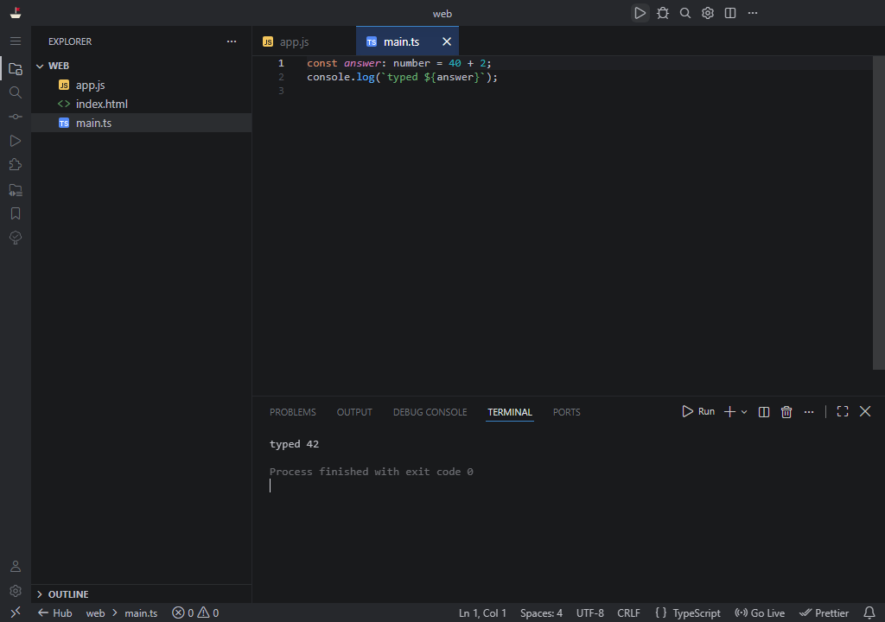

# Berthline

Portable coding profiles built on a pinned VSCodium. Extract it, open the Hub and start coding, with no install and no admin rights. Each profile keeps its own settings and extensions, so nothing touches an editor you already have.


## Download
Get the latest package from [Releases](https://github.com/RichardSpinola/berthline/releases).

| System | File | Download | Extracted |
|---|---|---|---|
| Windows 10 or 11, x64 | `berthline-windows.zip` | about 550 MB | about 1.1 GB |
| Linux x64 | `berthline-linux.tar.gz` | about 550 MB | about 1.5 GB |

`SHA256SUMS` in each release lets you check the files.

## First run
**Windows**
1. Extract the zip to a local folder, such as the Desktop. It runs slowly from a USB drive.
2. Open `Hub.exe`.
3. The package is not signed yet, so SmartScreen may warn you. Choose *More info*, then *Run anyway*.

**Linux**
```bash
tar -xzf berthline-linux.tar.gz
./berthline-linux/Hub
```

On Ubuntu 24.04 or later, the editor may need unprivileged user namespaces to start.

## Profiles
- **Java**: run with console input, debug, create classes and profile. The Java runtime is included, so you don't need to install a JDK.
- **Web**: HTML, CSS, JavaScript and TypeScript, with Node.js, Live Server, ESLint, Prettier and a REST client included.
- **Standard**: the plain editor.



## Portability and privacy
- Profiles, settings and extensions stay inside the Berthline folder.
- The list of trusted folders is stored in `.berthline-shared` in your user folder, and new projects go to `Projects` there. This is what stays on a shared computer.
- Telemetry and AI features are off by default. You can change them per app under Settings.

## Limitations
- Early preview: expect rough edges.
- No automatic updates yet. Download a new release to update.
- Git Graph is not included, because its license doesn't allow redistribution. You can install it from the Extensions view, and the built-in Source Control view shows a graph.
- A managed computer can block `.exe` files. Only its administrator can change that.

## Build
```bash
python3 -m venv .venv
.venv/bin/pip install PySide6 pyinstaller
.venv/bin/python build/build.py
```
The package lands in `dist/`. Tests live in `tests/` and run on GitHub Actions on Windows and Linux.

## AI use
This project was built with AI assistance: Claude Opus 5.5 (Anthropic), through Claude Code. A person reviewed the work and decided what to keep.

## License
MIT, see [LICENSE](LICENSE). Bundled software keeps its own license, see [NOTICE](NOTICE).

Not affiliated with VSCodium, Microsoft, JetBrains or Oracle.
