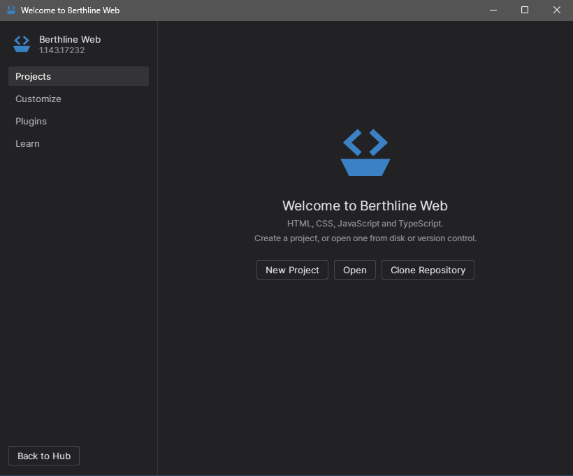

<div align="center">

<picture>
  <source media="(prefers-color-scheme: dark)" srcset="docs/images/logo-dark.svg">
  
</picture>

# Berthline

**A lighter editor that works closer to an IDE.**

A suite of ready-made editor profiles built on VSCodium, with one Hub to launch them.<br>
Java and Web today, more over time.

[](LICENSE)


[Download](#download) · [First run](#first-run) · [Profiles](#profiles) · [Why Berthline](#why-berthline) · [Limitations](#limitations)

</div>

> [!NOTE]
> Berthline is a personal project: a set of editor profiles, not a full IDE. Updates may take a while and some features may be missing. If something bothers you, open an issue or fork it and fix it your way, with AI or without.

<br>

<table>
  <tr>
    <td width="34%"></td>
    <td width="66%"></td>
  </tr>
</table>

## Download

Get the latest package from [Releases](https://github.com/RichardSpinola/berthline/releases).

| System | File | Download | Extracted |
|---|---|---|---|
| Windows 10 or 11, x64 | `berthline-windows.zip` | about 530 MB | about 1.1 GB |
| Linux x64 | `berthline-linux.tar.gz` | about 590 MB | about 1.5 GB |

`SHA256SUMS` in each release lets you check the files.

## First run

**Windows**

1. Extract the zip to a local folder, such as the Desktop. It runs slowly from a USB drive.
2. Open `Hub.exe`.
3. The package is not signed yet, so SmartScreen may warn you. Choose *More info*, then *Run anyway*.

**Linux**

```bash
tar -xzf berthline-linux.tar.gz
./berthline-linux/Hub
```

On Ubuntu 24.04 or later, the editor may need unprivileged user namespaces to start.

## Profiles

Each profile keeps its own settings and extensions, so nothing touches an editor you already have.

| | Profile | What you get |
|---|---|---|
|  | **Java** | Run with console input, debug, create classes and profile. The Java runtime is included, so you don't need to install a JDK. |
|  | **Web** | HTML, CSS, JavaScript and TypeScript, with Node.js, Live Server, ESLint, Prettier and a REST client. |
|  | **Standard** | The plain editor, for everything else. |


## Why Berthline

My computer is modest, and IntelliJ IDEA, which I use for my Java studies, was too heavy for it. So I started trying to bring VS Code as close as I could to the IntelliJ IDEA experience, using it as inspiration.

The goal isn't to turn an editor into a complete IDE. That barely makes sense. The goal is to get close enough that you can work comfortably on small and medium projects, and move to a full IDE when a project outgrows it.

Then the idea grew. Java was only the start. Berthline is meant to become a complete suite of profiles for different kinds of work, ready for anyone to use and change. Web came next, and more will follow. Keeping profiles apart also means a Java setup never slows down a Web project.

Berthline won't replace an IDE, and it has its own problems. It is one way to spend less of your computer's power while you code.

### The name

A *berth* is the place where a ship docks. A *line* is a shipping line, a fleet that sails under one flag. Berthline is a fleet of coding tools, and each one has its own berth.

### The look

The Hub's main screen is the Cargo: one boat per language, with its state and main action. A running app sails, a ready one rests at anchor, and the red flag only shows when something needs you. Editors keep a quiet dark theme, a choice of IntelliJ or VS Code shortcuts per app, and run buttons where you expect them.

The app icons follow the nautical theme. All of them share the same hull and change only the cargo: steam for Java, `< >` for Web and a prompt for Standard. The Hub is the ship with the red flag. They are flat, in solid colors, so they stay clear at small sizes.

## Portability and privacy

- Profiles, settings and extensions stay inside the Berthline folder.
- The list of trusted folders is stored in `.berthline-shared` in your user folder, and new projects go to `Projects` there. This is what stays on a shared computer.
- On Linux, the Hub adds a hidden shortcut to your user folder so the taskbar shows the right icon.
- The Hub asks GitHub for new versions when it opens, and sends nothing else. You can turn this off in Settings.
- Telemetry stays off. AI features are off by default, and you can turn them on per app under Settings.

## Limitations

- Early preview: expect rough edges.
- No automatic updates yet. Download a new release to update.
- A managed computer can block `.exe` files. Only its administrator can change that.

## Build from source

```bash
python3 -m venv .venv
.venv/bin/pip install PySide6 pyinstaller
.venv/bin/python build/build.py
```

The package lands in `dist/`. Tests live in `tests/` and run on GitHub Actions on Windows and Linux.

## AI use

AI did most of the work here: Claude Opus 5.5 (Anthropic), through Claude Code, built the profiles, settings, Hub and tests. I chose the direction, tested it and decided what to keep.

## License

MIT, see [LICENSE](LICENSE). Bundled software keeps its own license, see [NOTICE](NOTICE).

Not affiliated with or endorsed by VSCodium, Microsoft, JetBrains or Oracle. IntelliJ IDEA and VS Code are trademarks of their owners, mentioned only to describe where the inspiration comes from.
