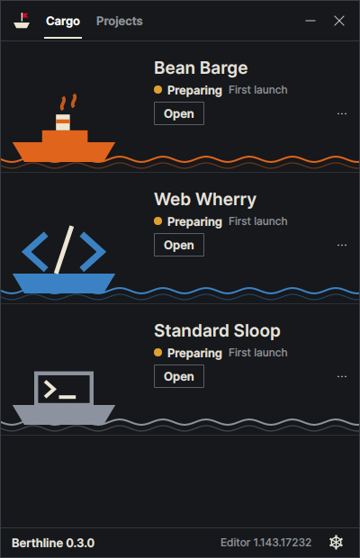
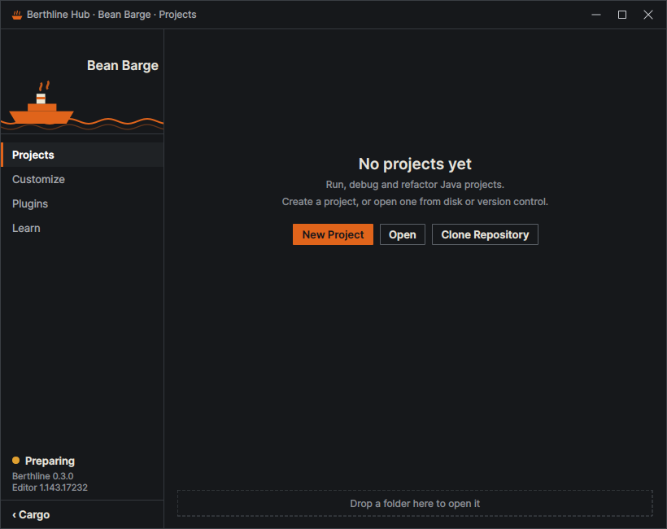
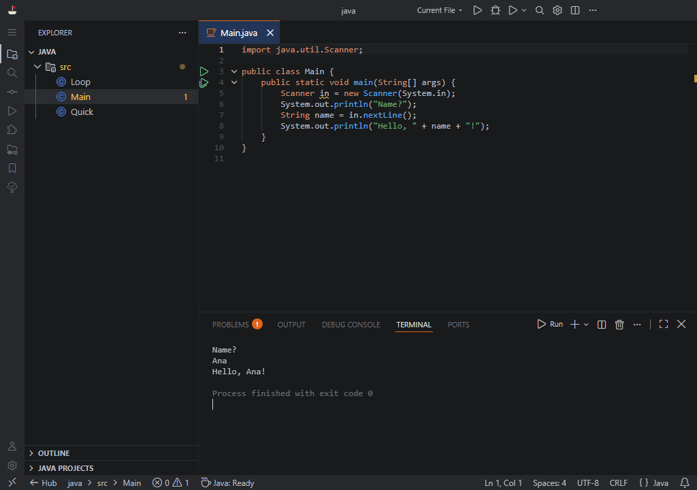

<div align="center">

<picture>
  <source media="(prefers-color-scheme: dark)" srcset="docs/images/logo-dark.svg">
  
</picture>

# Berthline

**A lighter editor that works closer to an IDE.**

Ready-made editor profiles built on VSCodium, with one Hub to launch them.

[](LICENSE)


[Download](#download) · [First use](#first-use) · [Profiles](#profiles) · [Limits](#limits) · [Docs](#docs) · [Português](README.pt-BR.md)

</div>

> [!NOTE]
> Berthline is a personal project: a set of editor profiles, not a full IDE. If something bothers you, open an issue or fork it and fix it your way.

<table>
  <tr>
    <td width="34%"></td>
    <td width="66%"></td>
  </tr>
</table>

## What it is

Each profile is an editor set up for one kind of work, with its own settings and extensions, so it
never touches an editor you already have. The Hub opens them, creates projects and keeps them up to
date. Everything stays inside the Berthline folder.

## Download

Get the latest package from [Releases](https://github.com/RichardSpinola/berthline/releases).

| System | File | Download | Extracted |
|---|---|---|---|
| Windows 10 or 11, x64 | `berthline-windows.zip` | about 530 MB | about 1.1 GB |
| Linux x64 | `berthline-linux.tar.gz` | about 590 MB | about 1.5 GB |

`SHA256SUMS` in each release lets you check the files.

## First use

**Windows:** extract the zip to a local folder (it runs slowly from a USB drive) and open `Hub.exe`.
The package is not signed yet, so SmartScreen may warn you: choose *More info*, then *Run anyway*.

**Linux:**

```bash
tar -xzf berthline-linux.tar.gz
./berthline-linux/Hub
```

On Ubuntu 24.04 or later, the editor may need unprivileged user namespaces to start.

The first start shows Setup: shortcuts, keymap for Bean Barge, project folders and theme. Everything
there can be changed later. New versions install from the Hub, keeping your settings, projects and
extensions.

## Profiles

| | Profile | For | Page |
|---|---|---|---|
|  | **Bean Barge** | Java: run with console input, debug, create classes, profile. Java runtime included. IntelliJ-style keys by default. | [docs](docs/profiles/bean-barge.md) |
|  | **Web Wherry** | HTML, CSS, JavaScript and TypeScript, with Node.js, a live preview beside the editor and DevTools. VS Code keys. | [docs](docs/profiles/web-wherry.md) |
|  | **Standard Sloop** | The plain editor, for everything else. | [docs](docs/profiles/standard-sloop.md) |



## Limits

- Early preview: expect rough edges and missing features.
- Not a full IDE. Small and medium projects work well; large ones are better in a full IDE.
- Windows and Linux x64 only. The Windows package is not signed.
- A managed computer can block `.exe` files. Only its administrator can change that.

## Docs

- Profiles: [Bean Barge](docs/profiles/bean-barge.md), [Web Wherry](docs/profiles/web-wherry.md), [Standard Sloop](docs/profiles/standard-sloop.md)
- [Measurements](docs/measurements.md): startup time and memory per profile
- [Privacy and portability](docs/privacy.md)
- [Build from source](docs/build.md)
- [AI use](docs/ai-use.md)
- [The name and the look](docs/name-and-look.md)
- [Roadmap](docs/ROADMAP.md)

## AI use

Most of Berthline was built with AI: Claude Opus 5.5 and Claude Fable 5.2 (Anthropic), through
Claude Code. I chose the direction, tested it and decided what to keep. Details in
[docs/ai-use.md](docs/ai-use.md).

## License

MIT, see [LICENSE](LICENSE). Bundled software keeps its own license, see [NOTICE](NOTICE).

Not affiliated with or endorsed by VSCodium, Microsoft, JetBrains or Oracle. Java is a trademark of
Oracle; IntelliJ IDEA and VS Code are trademarks of their owners, mentioned only to describe what the
profiles work with and where the inspiration comes from.
