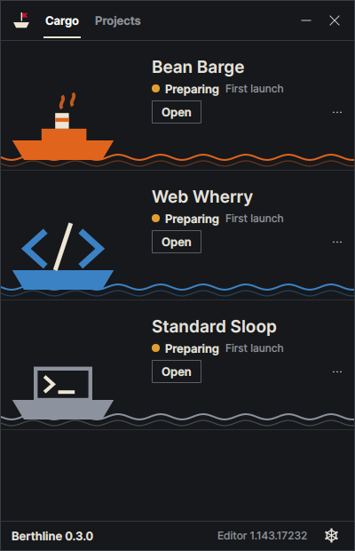
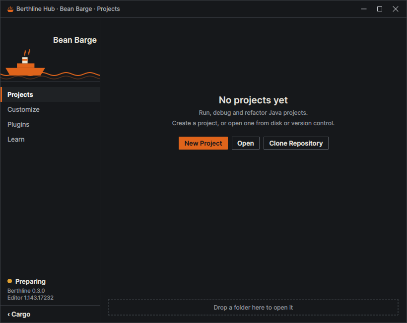

<div align="center">

<picture>
  <source media="(prefers-color-scheme: dark)" srcset="docs/images/logo-dark.svg">
  
</picture>

# Berthline

**Um editor mais leve que trabalha mais perto de uma IDE.**

Perfis de editor prontos, feitos sobre o VSCodium, com um Hub para abri-los.

[Baixar](#baixar) · [Primeiro uso](#primeiro-uso) · [Perfis](#perfis) · [Limites](#limites) · [Documentação](#documentação) · [English](README.md)

</div>

> [!NOTE]
> O Berthline é um projeto pessoal: um conjunto de perfis de editor, não uma IDE completa. Se algo incomodar, abra uma issue ou faça um fork e conserte do seu jeito.

<table>
  <tr>
    <td width="34%"></td>
    <td width="66%"></td>
  </tr>
</table>

## O que é

Cada perfil é um editor preparado para um tipo de trabalho, com ajustes e extensões próprios, sem
mexer em nenhum editor que você já tenha. O Hub abre os perfis, cria projetos e mantém tudo
atualizado. Tudo fica dentro da pasta do Berthline.

O programa está em inglês por enquanto.

## Baixar

Baixe o pacote mais recente em [Releases](https://github.com/RichardSpinola/berthline/releases).

| Sistema | Arquivo | Download | Extraído |
|---|---|---|---|
| Windows 10 ou 11, x64 | `berthline-windows.zip` | cerca de 530 MB | cerca de 1,1 GB |
| Linux x64 | `berthline-linux.tar.gz` | cerca de 590 MB | cerca de 1,5 GB |

O `SHA256SUMS` de cada release permite conferir os arquivos.

## Primeiro uso

**Windows:** extraia o zip numa pasta local (de pen drive fica lento) e abra o `Hub.exe`. O pacote
ainda não é assinado, então o SmartScreen pode avisar: escolha *Mais informações* e depois
*Executar assim mesmo*.

**Linux:**

```bash
tar -xzf berthline-linux.tar.gz
./berthline-linux/Hub
```

No Ubuntu 24.04 ou mais novo, o editor pode precisar de user namespaces sem privilégio para abrir.

Na primeira abertura aparece o Setup: atalhos, teclas do Bean Barge, pastas de projetos e tema. Tudo
pode ser mudado depois. Versões novas se instalam pelo Hub, mantendo ajustes, projetos e extensões.

## Perfis

| | Perfil | Para | Página |
|---|---|---|---|
|  | **Bean Barge** | Java: executar com entrada no console, depurar, criar classes, medir desempenho. Java incluído. Teclas no estilo IntelliJ por padrão. | [docs](docs/profiles/bean-barge.md) |
|  | **Web Wherry** | HTML, CSS, JavaScript e TypeScript, com Node.js, prévia ao vivo ao lado do editor e DevTools. Teclas do VS Code. | [docs](docs/profiles/web-wherry.md) |
|  | **Standard Sloop** | O editor puro, para todo o resto. | [docs](docs/profiles/standard-sloop.md) |

## Limites

- Prévia inicial: espere arestas e recursos faltando.
- Não é uma IDE completa. Projetos pequenos e médios vão bem; grandes ficam melhores numa IDE.
- Só Windows e Linux x64. O pacote de Windows não é assinado.
- Computador gerenciado pode bloquear `.exe`. Só o administrador muda isso.

## Documentação

As páginas em `docs/` estão em inglês: [perfis](docs/profiles/), [medições](docs/measurements.md),
[privacidade](docs/privacy.md), [compilar](docs/build.md), [uso de IA](docs/ai-use.md),
[nome e visual](docs/name-and-look.md) e [roadmap](docs/ROADMAP.md).

## Uso de IA

A maior parte do Berthline foi feita com IA: Claude Opus 5.5 e Claude Fable 5.2 (Anthropic), pelo
Claude Code. Eu escolhi a direção, testei e decidi o que ficava. Detalhes em
[docs/ai-use.md](docs/ai-use.md).

## Licença

MIT, veja [LICENSE](LICENSE). O software incluído mantém a própria licença, veja [NOTICE](NOTICE).

Sem vínculo com VSCodium, Microsoft, JetBrains ou Oracle. Java é marca da Oracle; IntelliJ IDEA e
VS Code são marcas de seus donos, citadas só para dizer com o que os perfis trabalham e de onde vem
a inspiração.
